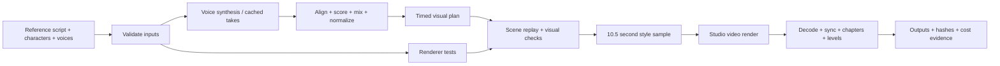

# Future Radio Benchmarks

**Make an episode. Keep the inputs. Show the receipt. Change one step and try again.**

Benchmark #000 is *The Benchmark Episode*: a frozen reference script and complete
283-line, nine-chapter audio/video baseline. It runs **10:09.29**, exceeding the
original approximate 7–9 minute target. All spoken lines are retained.

[Download baseline outputs](https://github.com/leo-guinan/future-radio-benchmarks/releases/tag/benchmark-000-v1) ·
[Cost ledger](benchmarks/000/baseline/costs.json) · [Cost accounting](docs/COSTS.md) ·
[Pipeline contract](docs/PIPELINE.md) · [Submit an experiment](CONTRIBUTING.md)



Each step declares its dependencies, command, input and output files in
[`pipeline/reference-v1.json`](pipeline/reference-v1.json). Recipes are ordinary
Python/JavaScript files. Replace a step or fork a recipe to test another method.
New runs freeze the selected inputs and recipe, record hashes and append cost and
resource evidence to a linked event log. Cached output reuse is checked by hash.

## Baseline, without hiding missing costs

| Item | Observed result |
| --- | ---: |
| Synthesis | 6,689 provider credits, nine calls |
| Combined provider request time | 146.400 seconds |
| Both local mixing attempts | 114.770 seconds |
| Style sample | 4.606 seconds |
| Full video capture and initial mux | 245.544 seconds |
| Recorded local stage time | 364.920 seconds |
| Original orchestration elapsed time | 991.9 seconds, including waits |
| MP4 output | 1280×720, 30 fps, nine chapters |
| Final video audio | −16.01 LUFS, −1.29 dBTP |
| Exact dialogue/source alignment | 283 of 283 lines |
| Renderer regression tests | 39 passed |
| Agent input / cached subset | 6,990,861 / 6,904,448 tokens |
| Agent output / reasoning subset | 38,353 / 10,971 tokens |
| Cash, human effort, energy | Unknown; not zero |

The synthesis account is grant-backed. Credits are measured; neither cash charges
nor an exchange rate are established. The ledger includes both local mixes, not
just the successful final attempt. It does not turn missing costs into a free episode.
These outputs are a **baseline review cut**. Human listening/editorial acceptance
and external audience/participation results remain pending. The public benchmark
repository publishes the evidence, not a claim of editorial acceptance.

## Reproduce without paid calls

Python 3.12, FFmpeg, and the pinned dependencies are required:

```sh
python3 -m venv .venv
source .venv/bin/activate
pip install -r recipes/reference-v1/requirements-production.txt
playwright install chromium
python tools/benchmark.py verify-baseline
python tools/benchmark.py plan
python tools/benchmark.py run --run-id replay-001 --target mix
```

The last command rebuilds the radio master using the nine cached voice takes. It
makes no paid requests. Outputs and event receipts go to `runs/replay-001/`.

```sh
python tools/benchmark.py run --run-id replay-001 --target verify-media
python tools/benchmark.py verify-run --run-id replay-001
python tools/benchmark.py fetch-outputs
```

The full pipeline renders a style sample, tests and captures the studio video,
then checks complete decoding, stream duration, chapters, alignment and levels.
Inspect the generated sample and contact sheets before treating a variant as a
quality improvement. Automated checks do not replace listening or editorial review.
Large original outputs (including the WAV, which exceeds GitHub's normal Git file
limit) live in the release and are checked against `artifacts.json` when downloaded.

## Verified cached replay

The complete nine-stage pipeline was replayed on the original machine in **334.856
seconds**, with **zero new synthesis credits**. The MP3, WAV and MP4 match the
baseline SHA-256 hashes exactly. The event journal, step timings, child-process CPU
usage and output comparison are preserved in [replications/cached-replay-001](replications/cached-replay-001/summary.json).
This is a same-machine reproduction, not an independent community submission.
A second invocation reused all nine verified checkpoints without rerunning them.

## Modify or replicate

**Reproduction:** same cached raw takes and recipe. Compare artifacts/hashes and
document platform/codec differences; byte identity across FFmpeg versions is not promised.

**Replication:** fresh voice takes using the same input/voice/model contract.
Cloud output may differ even with the same seed. New external synthesis requires
`ELEVENLABS_API_KEY` and explicit `--allow-paid`; personal credential files are never read.

**Variant:** copy `recipes/reference-v1/` and the pipeline config, point `recipe`
to the new directory, then change a stage. Use a new run ID so the original stays
intact. See the [worked variant recipe](docs/PIPELINE.md#change-a-step).

Two benchmark tracks: A preserves the fixed spoken script and compares production
methods; B uses an original script and a declared measurable goal. Track B needs
its own input set, recipe adapter and acceptance criteria. The bundled recipe is
for Track A. Submission deadline from the supplied challenge: **November 22, 2026**.

## Repository contents

- `benchmarks/000/reference/`: exact brief/script, characters, voice plan, raw takes,
  request bodies and provider alignment/cost receipts.
- `benchmarks/000/baseline/`: original measurements, known/unknown costs, artifact
  checksums and source manifest. Original receipts are historical evidence.
- `recipes/reference-v1/`: portable production code and the complete studio renderer.
- `pipeline/`: replaceable step definitions and optional rate assumptions.
- `tools/benchmark.py`: pipeline runner, incremental metering, cache verification,
  baseline checks, cost scenarios and output downloader.
- `artifacts/` and `runs/`: downloaded outputs and new experiments; ignored by Git.

See [provenance](PROVENANCE.md) for the imported renderer and what was changed.
Account-wide usage/quota, credentials and unrelated workspace history are excluded.
